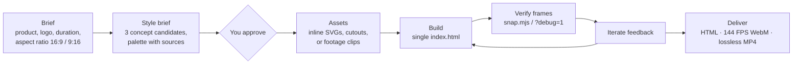

<div align="center">

# KinetRig 🎬

**Zero-dependency 144 FPS kinetic motion graphics & video engine built for AI coding agents.**<br>
Openers, promos, product demos, kinetic typography, and explainers — built as a single `index.html` with deterministic 144 FPS rendering and zero dropped frames.

[](README.md)
[](LICENSE)
[](#export--rendering-144-fps-engine)
[](#core-motion-laws-anti-powerpoint)
[](#quick-install)

[Why](#why) · [What you can make](#what-you-can-make) · [The menus behind the looks](#the-menus-behind-the-looks) · [Workflow](#recommended-workflow) · [Curated starters](#-curated-starters-assets) · [Export & rendering](#export--rendering-144-fps-engine) · [FAQ](#faq)

</div>

---

## Why

Ask an AI agent for "a video" and you usually get **slides**: one section per idea, a title, a photo, and a fade between them. **KinetRig** encodes what a seasoned motion designer insists on — a unified continuous world, a camera that actually travels in 3D space, a persistent subject, text that lives inside the scene, and zero amateur OS emojis (`🤖`, `⚡`, `🐙`).

Moreover, standard browser recording drops frames when complex WebGL or heavy CSS filters execute. KinetRig solves this with **deterministic offline timeline stepping** (`tl.time(t)` at `1/144s`), allowing any browser to render buttery-smooth 144 FPS videos with 0% frame loss.

| Traditional Approaches | KinetRig Engine |
|---|---|
| Heavy runtime bloat (Remotion, React, Manim) | **Pure Browser Native** (HTML5, GSAP, Three.js — double-click to play) |
| Dropped frames during real-time screen grab | **Deterministic 144 FPS** offline timeline stepping (0% frame drops) |
| OS emojis that pixelate on 1080p/4K | **100% Inline SVG Vectors** with neon glow & `currentColor` styling |
| Slide deck fades (feels like PowerPoint) | **Continuous 3D Camera** traveling, whip-pans & push-throughs |
| HUD buttons & mouse cursor in recordings | **Automatic Clean Capture** (`body.clean-capture` auto-hides UI & cursor) |

---

## What you can make

| Category | Deliverable | Typical length |
|---|---|---|
| 🎬 **Openers & promos** | Product launches, app teasers, brand manifestos | 15–40 s |
| 🖥️ **Product & SaaS demos** | Interactive UI tour, camera tracking user clicks & flows | 20–60 s |
| 🔤 **Kinetic typography** | Lyric statements, event releases, rhythmic text slam | 10–30 s |
| 📊 **Data & chart motion** | Live counters, SVG sparklines, dynamic bar/line visualizers | 15–45 s |
| 🛍️ **E-Commerce showcases** | 3D product cards, rotating specs, neon price badges | 15–30 s |
| 💬 **Diegetic chat simulation** | Realistic typing cadences, message bubble cascades | 15–40 s |
| 🧭 **Narrative explainers** | 6 explainer styles with continuous world & VO sync | 30–120 s |
| 🎥 **Footage layers** | Video clips locked frame-accurately to timeline clock (`clip()`) | — |

Every deliverable is a single self-contained `index.html`: double-click to play, autoplay + loop, `?debug=1` for scrub HUD, and in-browser or studio 144 FPS export.

---

## The menus behind the looks

<details>
<summary><b>10 style directions</b> — the skin, derived from your brand</summary>

| Direction | Background | Typography | Signature motion | Good for |
|---|---|---|---|---|
| **Cinematic dark** | near-black gradient, particles, bloom on objects | bold clean grotesk | push-through, light in front of lens | creative tools, gaming, tech |
| **Poster color-block** | large solid color fields changing per scene | ultra-heavy display, giant cropped letters | block wipes, text slamming frame edge | consumer apps, music, events |
| **Editorial light** | white/cream, generous space, hairlines | display serif + small grotesk | calm slides, lines that draw | productivity, finance, SaaS |
| **Paper & print** | paper texture, collage, stamps, tape | handwriting + serif | objects flying in and landing | education, community, food |
| **Retro / analog** | faded color, grain, scanlines | 70s–90s geometric | controlled glitch, rough zoom, freeze | nostalgia, music, entertainment |
| **Brutalist mono** | black and white, hard grid | monospace + condensed | hard cuts, shifting blocks, blinking cursor | developer tools, CLI infra |
| **Pastel playful** | stacked pastels, big round shapes | heavy rounded sans | elastic bounce, blooming shapes | kids, health, lifestyle |
| **Luxury dark** | black + gold/bronze, soft shadows | tall wide-tracked serif | slow motion, sweeping light, depth | fashion, automotive, luxury |
| **Flat pop with photos** | neutral light alternating with solid brand fields | rounded heavy sans + giant cropped words | cutouts popping in, stickers snapping on beat | consumer apps, fintech, e-commerce |
| **Grainy gradient** | deep base, saturated glowing shapes, fine grain | small clean grotesk or minimal heavy display | layers opening, camera through shape, guiding orb | tech, AI, music, premium launches |

</details>

<details>
<summary><b>19 opener concepts</b> — the structure, chosen per product</summary>

| # | Concept | Signature motion | Good for |
|---|---|---|---|
| 1 | **One continuous shot** | unbroken camera travel through entire narrative | creative tools, hardware, spaces |
| 2 | **Pure typography** | kinetic words forming and reconstructing scene | strong taglines, events, releases |
| 3 | **Problem → gone** | chaotic elements wiped out by clean product solution | productivity, utilities, workflows |
| 4 | **Before / after** | split-screen or wipe contrast between states | editors, filters, optimization |
| 5 | **Journey inside the UI** | camera flying through giant 3D UI layers | apps with distinctive UI systems |
| 6 | **Product macro** | extreme close-up gliding over textures | hardware, packaging, F&B, fashion |
| 7 | **Object metaphor** | symbolic object mutating to convey feature | security, cloud infra, finance |
| 8 | **Living number** | massive metric counter driving kinetic choreography | milestones, stats, speed records |
| 9 | **One feature fully demoed** | single hero workflow shown end-to-end | apps with one killer differentiator |
| 10 | **Diegetic question → answer** | conversational prompt answered by UI action | AI agents, search, support |
| 11 | **Rhythmic collage** | fast beat-matched image/vector cuts | music, lifestyle, youth brands |
| 12 | **Logo as stage** | logo geometry opens up into entire scene | brands with iconic geometric logos |
| 13 | **Object relay** | continuous handoff between floating assets | e-commerce, logistics, marketplaces |
| 14 | **Brand system showcase** | design tokens, typography, and colors dancing | launches, rebrands, design systems |
| 15 | **Claim → how → result** | three-beat thesis proven visually | new features, generative AI tools |
| 16 | **Living UI ecosystem** | interconnected cards exchanging live signals | B2B SaaS, automation platforms |
| 17 | **Flat pop with photos** | paper cutouts snapping in with colored stickers | consumer fintech, social apps |
| 18 | **Through the gradient shapes** | camera diving through luminous neon portals | AI platforms, deep tech, security |
| 19 | **Product tour with claims** | key features highlighted along a continuous ribbon | SaaS suites, dashboards, team tools |

</details>

<details open>
<summary><b>6 explainer styles</b> — each with its own starter</summary>

| Style | Look | Best for |
|---|---|---|
| **Continuous action** | flowing vector world, one subject that never leaves, changing viewpoints | speed, routes, processes |
| **Cartoon collage** | cream paper, flat illustration cutouts, handwriting, color pills | science, education |
| **Visual journalism** | black, real photos with source tags, highlighter, dashed annotations | news, current issues |
| **White catalog** | white grid, photo cutouts, mixed typography, scribbles | products, brands |
| **Vintage sketch** | sepia paper, engraving art, classic serifs, rust annotations | history, biography |
| **Cartoon stage** | one stage per scene, jointed characters, no captions | education with characters |

</details>

---

## Recommended workflow



1. **Brief the agent:** Define product, duration (15–30s opener, 30–60s explainer), aspect ratio (`16:9` or `9:16`), and audio.
2. **Approve the style brief:** Agent proposes 3 Concept Candidates with palette (3 HEX colors stating sources) and rationale before coding.
3. **Settle the assets:** Use resolution-independent inline SVGs (`<svg viewBox="0 0 24 24">`) — zero system emojis allowed.
4. **Build from starter:** Adapt the corresponding starter from `assets/` into a single self-contained `index.html`.
5. **Verify keyframes:** Use `node scripts/snap.mjs shots 1 3 5` to inspect text overlaps and camera settling.
6. **Deliver:** Enjoy pure browser playback, instant 144 FPS in-browser WebM recording, or headless MP4 frame export.

---

## 📦 Curated Starters (`assets/`)

### Brand Openers & Narrative
1. **`starter-opener.html`** — High-impact brand opener with continuous 3D camera, macro zoom, Three.js particle space, and kinetic text.
2. **`starter-explainer.html`** — Continuous action explainer with camera traveling through a unified world.

### Explainer Styles
3. **`starter-explainer-kartun.html`** — Paper & print cartoon collage explainer with cutout illustrations and drop shadows.
4. **`starter-explainer-jurnalisme.html`** — Visual journalism explainer with editorial framing and data evidence.
5. **`starter-explainer-katalog.html`** — Clean white catalog explainer for minimalist product or portfolio showcases.
6. **`starter-explainer-panggung.html`** — Cartoon stage explainer with proscenium depth, curtains, and spotlight entries.
7. **`starter-explainer-sketsa.html`** — Vintage sketch explainer with textured blueprints and architectural hatching.

### Interactive & Product Simulation
8. **`starter-data.html`** — Data animation with animated metric counters, dynamic SVG bar/line charts, and KPI pulse cards.
9. **`starter-ecommerce.html`** — 3D product showcase card with price badge, specs matrix, and CTA glow.
10. **`starter-chat.html`** — Diegetic text message & conversational chat simulation with realistic typing cadence.

---

## 🚀 Quick Install

### As an Agent Skill (Claude Code, Cursor, Codex, ChatGPT)
```bash
npx -y skills@latest add https://github.com/Reff33/KinetRig --copy --yes
```

### Manual Installation
```bash
git clone https://github.com/Reff33/KinetRig.git
```

| Environment | Setup |
|---|---|
| **Claude Code** | Place in `~/.claude/skills/kinet-rig` |
| **Cursor / Copilot** | Copy repository and link `SKILL.md` in `.cursor/rules` |
| **Browser / Local** | Double click any `.html` file inside `assets/` |

---

## 🎥 Export & Rendering (144 FPS Engine)

### Option A: Clean In-Browser Capture (Instant WebM)
Every starter includes a floating top-bar **`Download Video (144 FPS)`** button.
- When clicked, `body.clean-capture` auto-hides all UI buttons, HUD scrubbers, and passes `cursor: 'never'` to `getDisplayMedia`.
- Records at 144 FPS and 40 Mbps bitrate (`videoBitsPerSecond: 40000000`).

### Option B: Studio Offline Render (Zero Drops Guaranteed)
```bash
# 1. Start local server
npx serve . -p 5178

# 2. Render clean frames frame-by-frame (default 144 FPS)
node scripts/export-frames.mjs

# 3. Assemble lossless MP4 with ffmpeg
ffmpeg -framerate 144 -i frames/f%05d.png -c:v libx264 -pix_fmt yuv420p -crf 14 output_144fps.mp4
```

### Option C: Visual Keyframe Snapshot (Quick AI Inspection)
```bash
# Snapshot critical seconds without full render
node scripts/snap.mjs shots 1 3.5 8 12 18
```

---

## 📜 Core Motion Laws (Anti-PowerPoint)

1. **Continuous World:** Scenes never fade like static slides. Transitions are driven by continuous camera travel, push-throughs, or motivated object wipes.
2. **Zero OS Emojis:** NEVER use system emojis (`🤖`, `⚡`, `🐙`, `🎥`, `⚙`). ALWAYS use resolution-independent inline SVG vectors (`<svg viewBox="0 0 24 24">`) with `currentColor` and glow filters.
3. **Deterministic Timelines:** All animations are driven strictly by `tl.time()`. Never use non-deterministic `Date.now()` or `Math.random()`.
4. **One Statement Per Shot:** Keep text under 5 words per beat. Let motion, depth, and spatial geometry convey emotion.

---

## 📂 Repository Layout

```
KinetRig/
├── SKILL.md                         Agent specification & instructions
├── README.md                        Full documentation & style guides
├── assets/                          10 production-ready starter templates
│   ├── starter-opener.html          3D camera brand opener
│   ├── starter-explainer.html       Continuous action explainer
│   ├── starter-explainer-kartun.html Cartoon collage explainer
│   ├── starter-explainer-jurnalisme.html Visual journalism explainer
│   ├── starter-explainer-katalog.html White catalog explainer
│   ├── starter-explainer-panggung.html Cartoon stage explainer
│   ├── starter-explainer-sketsa.html Vintage sketch explainer
│   ├── starter-data.html            Data & animated charts
│   ├── starter-ecommerce.html       3D product showcase
│   └── starter-chat.html            Diegetic chat simulation
├── references/                      Comprehensive motion design manuals
│   ├── 144fps-guide.md              144 FPS offline stepping formulas
│   ├── anti-ppt.md                  30+ slide violations & motion remedies
│   ├── opener-konsep.md             19 opener concept formulas
│   ├── explainer.md                 Camera recipes & footage layers
│   ├── kartun-panggung.md           Stage depth & character puppet laws
│   ├── techniques.md                Typography & transition mechanics
│   ├── svg-icons.md                 Zero-emoji vector library
│   ├── architecture.md              Rig structure & determinism
│   └── roadmap.md                   Future engine milestones
└── scripts/                         Production tools
    ├── export-frames.mjs            Deterministic 144 FPS headless renderer
    └── snap.mjs                     Instant keyframe snapshot validator
```

---

## FAQ

<details>
<summary><b>Is the output a video file?</b></summary>

The deliverable is a self-contained `index.html` that plays natively in any browser with autoplay and loop. When a video file is needed, use the built-in 144 FPS clean download button (instant WebM) or run `node scripts/export-frames.mjs` with `ffmpeg` for broadcast-grade MP4s.
</details>

<details>
<summary><b>Will every video end up looking the same?</b></summary>

Never. That is the fundamental reason KinetRig enforces a required style brief. The color palette and visual tokens are extracted directly from your brand, while the structure is picked from a library of 19 opener concepts and 6 explainer styles.
</details>

<details>
<summary><b>Can I give it a reference video?</b></summary>

Yes. AI agents extract rhythm, camera momentum, and energy from your reference video, while generating original layouts, typography, and palettes tailored to your brand.
</details>

<details>
<summary><b>Do I need photos?</b></summary>

Only for photo-based styles like Visual Journalism or Flat Pop. For tech openers, SaaS demos, and kinetic typography, KinetRig relies entirely on code-driven CSS transforms, Three.js particles, and inline SVGs.
</details>

<details>
<summary><b>Can I use video clips?</b></summary>

Yes. Video files can be bound as footage layers via the `clip()` helper. The video's playback clock locks directly to the GSAP timeline position (`tl.time()`), guaranteeing perfect sync even during frame-by-frame 144 FPS export.
</details>

<details>
<summary><b>Can it build in After Effects?</b></summary>

Yes, for cartoon explainers: with After Effects open and the Higgsfield MCP bridge connected, the agent builds compositions, characters, and keyframes directly in AE.
</details>

<details>
<summary><b>Why 144 FPS offline rendering?</b></summary>

Real-time browser screen recording often drops frames under heavy WebGL shaders or intensive CSS motion blur. Offline rendering mathematically pauses the timeline at exact `1/144s` increments, waits for GPU paint ticks, and captures screenshots, guaranteeing pristine 144 FPS output.
</details>

---

## Contributing

Issues and pull requests are welcome. When submitting a new starter or motion recipe, ensure it adheres to the zero-dependency rule, uses 100% inline SVG vectors, and functions deterministically with `OPENER.seek(t)`.

---

## 💡 Acknowledgements & Origins

- Explainer choreography, stage mechanics, and narrative concept structures adapted from the [Bang Motion](https://github.com/bangtutorial/bang-motion) methodology by [Bang Tutorial](https://youtube.com/bangtutorial).
- Built, elevated, and maintained as **KinetRig** with 144 FPS deterministic offline rendering pipelines, 40 Mbps clean browser streams, and strict zero-emoji vector standards by [Reff33](https://github.com/Reff33).

---

## 📄 License

[MIT](LICENSE) © 2026 [Reff33](https://github.com/Reff33)
